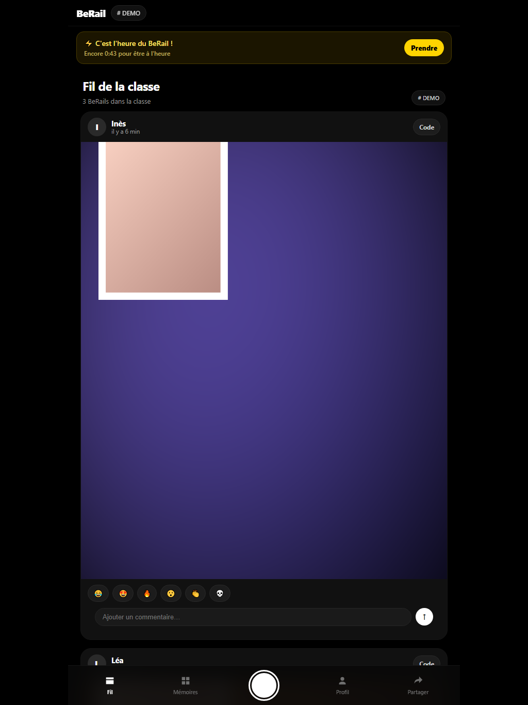
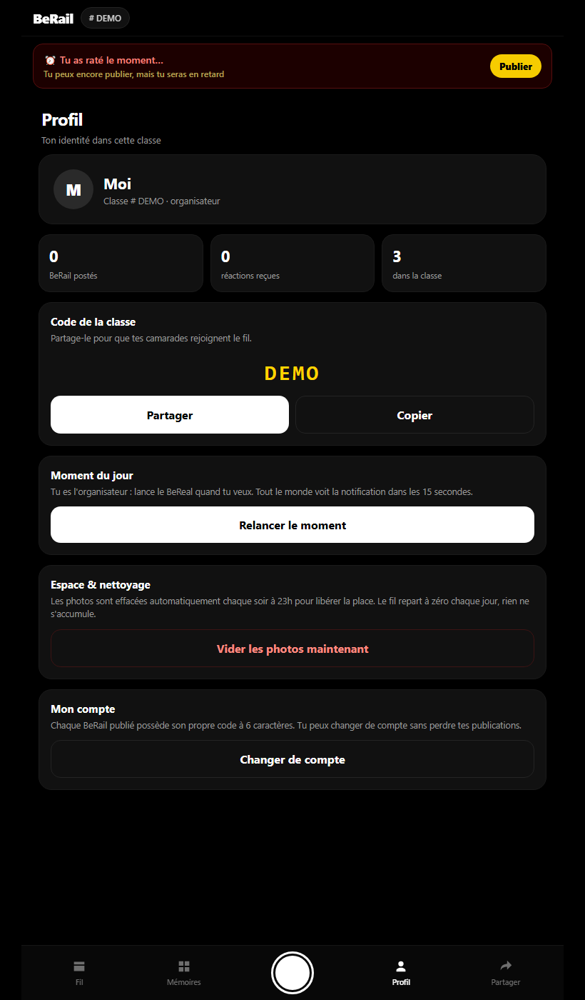
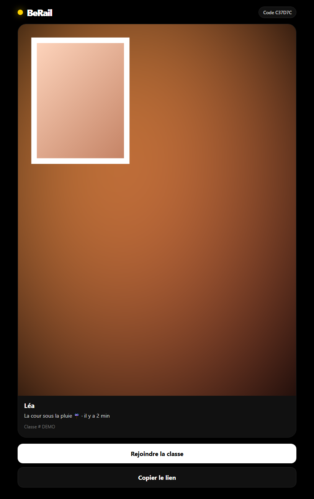

# BeRail

**Le BeReal de ta classe.** Un moment lancé par le prof, deux photos (arrière + avant),
un fil privé, et **chaque BeRail se partage avec un code à 6 caractères**.

Conçu pour les iPads en classe : interface **Liquid Glass** (verre dépoli, dégradés animés),
pas de compte, pas d'e-mail, pas d'installation.
Les élèves entrent un prénom et le code de la classe, et c'est parti.
**Les photos sont effacées chaque soir** : le fil repart de zéro le lendemain, rien ne s'accumule.



| Profil de l'organisateur | Un BeRail ouvert par son code |
|---|---|
|  |  |

## En ligne sur Firebase

L'app tourne sur **https://berail-lucas.web.app** (Firebase Hosting, projet `sync-3626f`).
Les données (classes, comptes, BeRail, photos, réactions, commentaires) sont dans
Firebase Realtime Database sous le nœud `/berail`, via `public/firebase-api.js` :
plus besoin du serveur Node ni de Render. Les BeRail restent 7 jours puis sont effacés.

Règles de sécurité du nœud `/berail` : `database.rules.berail.json` (à fusionner dans les règles du projet).

## Lancer

```bash
npm start
```

ou double-clic sur `demarrer.cmd` (Windows). Node 18+ suffit, **aucune dépendance**.

Le serveur écoute sur :

- `http://localhost:3000` — pour tester sur l'ordinateur
- `https://<IP-du-PC>:3443` — **l'adresse à ouvrir sur les iPads** (la caméra Safari exige HTTPS)

L'IP locale est affichée au démarrage. La première fois, génère le certificat :

```bash
openssl req -x509 -newkey rsa:2048 -nodes \
  -keyout certs/key.pem -out certs/cert.pem -days 825 \
  -subj "/CN=berail.local" \
  -addext "subjectAltName=DNS:localhost,IP:127.0.0.1,IP:192.168.1.187"
```

(remplace l'IP par celle du PC ; `certs/` n'est jamais commité)

## Sur iPad

1. Mettre l'iPad sur le **même Wi-Fi** que l'ordinateur.
2. Safari → `https://192.168.1.187:3443`
3. Avertissement du certificat auto-signé : **Afficher les détails → visiter ce site**.
4. Autoriser la caméra.
5. Optionnel : **Partager → Sur l'écran d'accueil** pour l'avoir comme une app.

> Si le certificat bloque, l'app bascule automatiquement sur l'appareil photo de l'iPad
> (deux photos à choisir). Tout le reste fonctionne à l'identique.

## Utilisation

| Qui | Quoi |
|---|---|
| Le prof | Crée la classe avec un code (ex. `4B-2026`), puis **Profil → Lancer le moment** |
| Les élèves | Entrent leur prénom + le code de la classe |
| Tout le monde | Gros bouton : photo arrière, photo avant, légende, publier |
| Partage | Bouton **Code** sur un post → code à 6 caractères + lien `/?p=CODE` |

- Publier dans les **2 minutes** après le moment = à l'heure, ensuite le post porte **⚠️ En retard**.
- Réactions emoji, commentaires, mémoires, fil de la classe.

**Classe 209** : elle est déjà créée. Le premier qui entre devient organisateur (le prof, de préférence).
`npm run seed` crée une classe de test avec 3 posts.

## Nettoyage automatique des photos

C'est le serveur qui garde les photos. Pour ne pas remplir le disque (surtout sur Render),
tout est effacé **chaque soir** :

- à l'heure configurée (`PURGE_HOUR`, 23 h par défaut, fuseau `TZ_NAME` = Europe/Paris),
  tous les posts du jour sont supprimés **avec leurs fichiers image** ;
- le moment en cours de chaque classe est remis à zéro ;
- au passage minuit, tout post de la veille est également supprimé.

Le compte des élèves et les codes de classe restent en place : seul le contenu du jour part.
L'organisateur peut aussi vider à la main : **Profil → Vider les photos maintenant**
(`POST /api/purge`).

| Variable | Défaut | Rôle |
|---|---|---|
| `PURGE_HOUR` | `23` | Heure du nettoyage (0–23), dans le fuseau ci-dessous |
| `TZ_NAME` | `Europe/Paris` | Fuseau utilisé pour « la fin de la journée » |
| `DATA_DIR` | `./data` | Dossier des photos + `db.json` (à monter sur un disque persistant) |

## Admin, horaires et notifications

- App publique : https://berail-lucas.web.app
- Admin : https://berail-lucas.web.app/admin (mot de passe admin)
- `push/` : petit serveur Node (Render, offre gratuite) qui envoie les notifications Web Push,
  lance les BeRail automatiques aux horaires réglés dans l'admin et efface les BeRail de plus de 7 jours.
  Ses secrets sont chiffrés dans `push/secrets.enc` ; seule la variable `BERAIL_SECRET` est à régler sur Render.
- `.github/workflows/berail-reveil.yml` réveille ce serveur toutes les 5 minutes.
- Sur iPad/iPhone, les notifications marchent quand BeRail est ajouté à l'écran d'accueil (iPadOS 16.4+).

## Déployer sur Render

Le dépôt est prêt pour un **Blueprint** ([`render.yaml`](render.yaml)) :
service Node, disque de 1 Go monté sur `/var/data`, fuseau Paris, purge à 23 h.

1. [render.com](https://render.com) → **New → Blueprint** → connecte ton compte GitHub.
2. Choisis le dépôt `berail`, valide le blueprint, déploie.
3. Render fournit une URL `https://berail-xxxx.onrender.com` en HTTPS valide :
   **la caméra fonctionne directement**, pas d'avertissement de certificat.

Deux points à connaître :

- Le **disque persistant** (1 Go) demande le plan *Starter* (~7 $/mois). Sur le plan gratuit,
  le disque est éphémère : les photos disparaissent à chaque redéploiement ou mise en veille.
  Pour rester gratuit, retire le bloc `disk`, laisse `DATA_DIR` par défaut, et accepte que
  les photos ne survivent pas à un redémarrage.
- Le nettoyage du soir tourne **dans le serveur** : pas de cron à configurer.
  Sur Render, `TZ_NAME=Europe/Paris` est déjà réglé dans `render.yaml`.

## API

| Méthode | Route | Rôle |
|---|---|---|
| `POST` | `/api/join` | Rejoindre/créer une classe (`name`, `code`, `create`) |
| `GET` | `/api/me?token=` | Profil + classe |
| `GET` | `/api/feed?token=` | Fil de la classe |
| `GET` | `/api/state?token=` | Moment en cours, nombre de posts (polling 15 s) |
| `POST` | `/api/moment` | Lancer le moment (organisateur uniquement) |
| `POST` | `/api/post` | Publier un BeRail (photo composite data-URL) |
| `POST` | `/api/react` | Réagir (bascule un emoji) |
| `POST` | `/api/comment` | Commenter |
| `GET` | `/api/p/∶code` | Un BeRail par son code, **sans compte** |
| `POST` | `/api/purge` | Supprimer les photos du jour (organisateur) |

## Structure

```
server.js            HTTP + HTTPS, API JSON, nettoyage quotidien, stockage fichier
public/index.html    interface
public/app.js        logique client (vanilla)
public/styles.css    thème sombre façon BeReal
seed.js              classe de test avec 3 posts
gen-icons.js         icônes PWA
render.yaml          blueprint Render (disque, fuseau, purge)
data/db.json         comptes, classes, posts (non commité)
data/media/          photos (non commité)
certs/               certificat auto-signé (non commité)
```

## Limites de la V1

- Les **notifications** ne sont pas de vraies push : l'app ouverte vérifie toutes les 15 s.
- Pas encore de **suppression individuelle** ni de verrou « un seul post par moment ».
- Les photos sont stockées en clair sur le disque du serveur, et supprimées chaque soir.
  Un code de classe = accès au fil.
- `?as=Prénom&code=CODE` permet de pré-remplir la connexion (pratique pour une démo/kiosque).

## Licence

MIT — voir [LICENSE](LICENSE).
